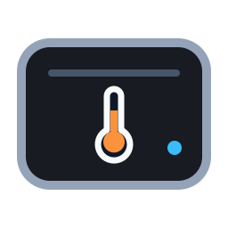
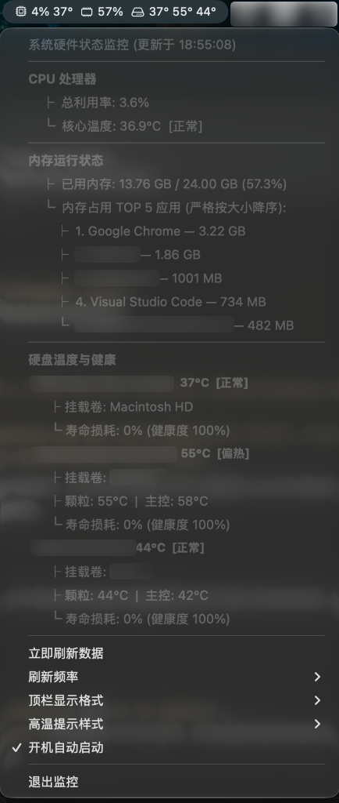

<div align="center">



# DiskTempBar

**Ultra-lightweight macOS Menu Bar Monitor for NVMe SSD Temperature, CPU & RAM**

*专为 macOS 设计的极简原生菜单栏监控工具：外置雷电/USB4 NVMe 固态硬盘温度 · Apple Silicon CPU 核心温度 · 内存占用与实际 TOP 5 应用排行*

[](https://www.apple.com/macos/)
[-orange.svg?style=flat-square)](https://support.apple.com/en-us/HT211814)
[](https://swift.org/)
[](#)
[](LICENSE)

<br/>



</div>

---

## 💡 为什么需要 DiskTempBar？(The Problem)

随着 Apple Silicon Mac 用户大量普及**雷电 3/4 或 USB4 外置 NVMe 移动固态硬盘**（如三星 970/980/990 EVO、致态、西数 SN850X、长城 GT70 等），发热掉速与掉盘风险已成为日常痛点：

1. **系统原生盲区**：macOS 自带的「活动监视器」完全**无法显示任何硬盘温度**，对外置盘更是两眼一抹黑。
2. **现有开源软件局限**：
   - **Stats / iStat Menus**：偏重，对雷电 NVMe 硬盘盒（如 JHL7440、ASM2464、RTL9210 等主控方案）常识别不到温度或显示 `--°C`；
   - **TG Pro**：闭源收费商业软件，后台服务常驻且较为臃肿。
3. **视觉噪音过大**：许多工具动辄弹红闪烁或加入感叹号警告，破坏 macOS 原生菜单栏的克制与优雅。

**DiskTempBar** 由此诞生——**纯原生 Swift + AppKit** 单文件构建，**无第三方框架依赖**，**内存常驻仅 ~15MB**，**CPU 占用 0.0%**，真正实现“即时看一眼顶栏即可心中有数”。

---

## 🚀 核心特性 (Key Features)

- 🌡️ **全盘 NVMe 硬件直通监测**：
  - 实时采集内置 Apple SSD 与外置雷电/PCIe NVMe 固态硬盘温度。
  - 下拉菜单直观显示**闪存颗粒温度**、**主控芯片温度**、**挂载卷**及**寿命损耗百分比（健康度）**。
- 🔥 **Apple Silicon 核心温度直读**：
  - 直接调用底层 Apple IOHID C-API 采集 M1/M2/M3/M4 系列芯片真实核心平均温度与整体利用率。
  - **无需任何内核驱动（Kext）**，**无需关闭 SIP 系统完整性保护**。
- 🧠 **内存真实 TOP 5 应用排行**：
  - 精确计算物理内存已用与占用百分比。
  - 自动聚合 App 主进程并按实际内存大小**严格降序排列**，精准揪出内存杀手。
- 🎨 **4 种极简顶栏格式自由切换**：
  1. **极简矢量图标风格（默认）**：`[cpu] 4% 37°  [ram] 57%  [drive] 37° 55° 44°`
  2. **紧凑最高温风格**：仅显示当前各硬件最高温度，紧凑不占位置。
  3. **纯文字工业风**：`CPU 4% 37° · RAM 57% · SSD 37° 55° 44°`
  4. **极简纯数字风格**：无任何图标与前缀，极致收敛。
- 🛡️ **优雅不打扰的高温提示**：
  - 彻底去除突兀的三角感叹号图片与警告 Emoji，绝不抖动菜单栏。
  - 支持「**极致纯净（默认）**」与「**温和暖色（超温数字柔和橙色高亮）**」两种风格。
- ⚡ **开机自动启动**：
  - 内置原生 `LaunchAgent` 管理，菜单内点击即可随时启用或关闭开机自启。
- 🪶 **极致羽量级**：
  - 应用打包体积仅 **~62 KB**，常驻内存 **< 15 MB**，0 外部包依赖。

---

## 📊 对比主流工具 (Comparison)

| 特性 | **DiskTempBar** | Stats | iStat Menus | TG Pro |
| :--- | :---: | :---: | :---: | :---: |
| **外置雷电 NVMe 颗粒/主控分部温度** | **完美原生支持** | 部分缺失 | 部分缺失 | 支持 |
| **常驻内存占用** | **~15 MB** | 80~150 MB | 100~200 MB | 60~120 MB |
| **CPU 占用** | **0.0%** | 0.5%~2.0% | 1.0%~3.0% | 0.5%~1.5% |
| **应用安装体积** | **~62 KB** | ~35 MB | ~50 MB | ~20 MB |
| **代码依赖** | **0 外部包 (纯 Swift)** | 较多依赖 | 商业闭源 | 商业闭源 |
| **开源免费** | **MIT 开源** | 开源 | 收费 ($14+) | 收费 ($10+) |

---

## 🛠️ 系统环境依赖 (Prerequisites)

1. **操作系统**：macOS 12.0 (Monterey) 或更高版本（针对 macOS 14 Sonoma 与 macOS 15 Sequoia 进行原生优化）。
2. **硬件平台**：Apple Silicon (M1 / M2 / M3 / M4 系列芯片，Mac mini, MacBook, Mac Studio, Mac Pro)。
3. **S.M.A.R.T. 底层工具**：
   用于直通读取雷电盒内 NVMe 的底层健康与温度传感器寄存器：
   ```bash
   brew install smartmontools
   ```

---

## 📦 安装与使用 (Installation)

### 方式 1：直接下载 Release 预编译包（推荐）

1. 前往本仓库右侧 **[Releases](https://github.com/forest/DiskTempBar/releases)** 页面；
2. 根据你的使用习惯下载对应格式（均适配 Apple Silicon）：
   - **`DiskTempBar-v1.0.0.dmg`**（推荐）：macOS 磁盘镜像，双击挂载后将 App 拖入应用程序文件夹；
   - **`DiskTempBar-v1.0.0.zip`**：便携轻量绿色包（仅 ~62 KB），解压后直接双击使用；
   - **`DiskTempBar-v1.0.0.pkg`**：系统标准安装向导包，双击下一步即可自动安装到 `/Applications`。
3. 双击打开，应用将立刻驻留在屏幕右上角菜单栏。
   > *提示：首次打开若系统提示未签名，请在「系统设置」→「隐私与安全性」中点击「仍要打开」。*

---

### 方式 2：终端一键克隆构建（适合开发者）

如果你本地已安装 Xcode Command Line Tools，只需在终端运行：

```bash
# 1. 克隆本仓库
git clone https://github.com/forest/DiskTempBar.git
cd DiskTempBar

# 2. 执行一键构建并自动启动
bash install.sh
```

---

### 方式 3：单行命令手动编译

无需打开 Xcode，原生 `swiftc` 仅需 1 秒即可完成编译：

```bash
swiftc -O -target arm64-apple-macosx14.0 main.swift -o DiskTempBar
```

---

## 🔒 权限与安全性说明 (Security & Privacy)

- **无 Root 常驻权限**：日常运行不需要以 `root` 或 `sudo` 身份常驻后台。
- **无内核扩展（No Kext）**：基于 macOS 原生 `IOHIDEventSystem` 和通用用户态工具读取，**不需要降低系统安全性**，**不需要关闭 SIP**。
- **完全本地化**：零网络请求，不收集任何用户隐私数据或设备硬件序列号。

---

## ⚙️ 常见问题 (FAQ)

<details>
<summary><b>Q: 为什么外置硬盘拔掉后顶栏会怎么样？</b></summary>
DiskTempBar 会在下一个刷新周期（默认 3 秒）自动感知外置硬盘移除，动态缩减顶栏显示的温度数量，绝不会发生崩溃或错误弹窗。重新插上后会自动恢复探测。
</details>

<details>
<summary><b>Q: 如何修改刷新频率？</b></summary>
点击顶栏图标展开菜单，在「刷新频率」子菜单中可自由切换为：2秒、3秒（推荐）、5秒、10秒或 30秒。设置会自动持久化保存。
</details>

<details>
<summary><b>Q: 如何彻底卸载？</b></summary>
在顶栏菜单中取消勾选「开机自动启动」，点击「退出监控」，然后将 <code>/Applications/DiskTempBar.app</code> 移入废纸篓即可。
</details>

---

## 📄 开源许可证 (License)

本项目采用 [MIT License](LICENSE) 开源许可证。欢迎提交 Issue 与 Pull Request 共同完善！
